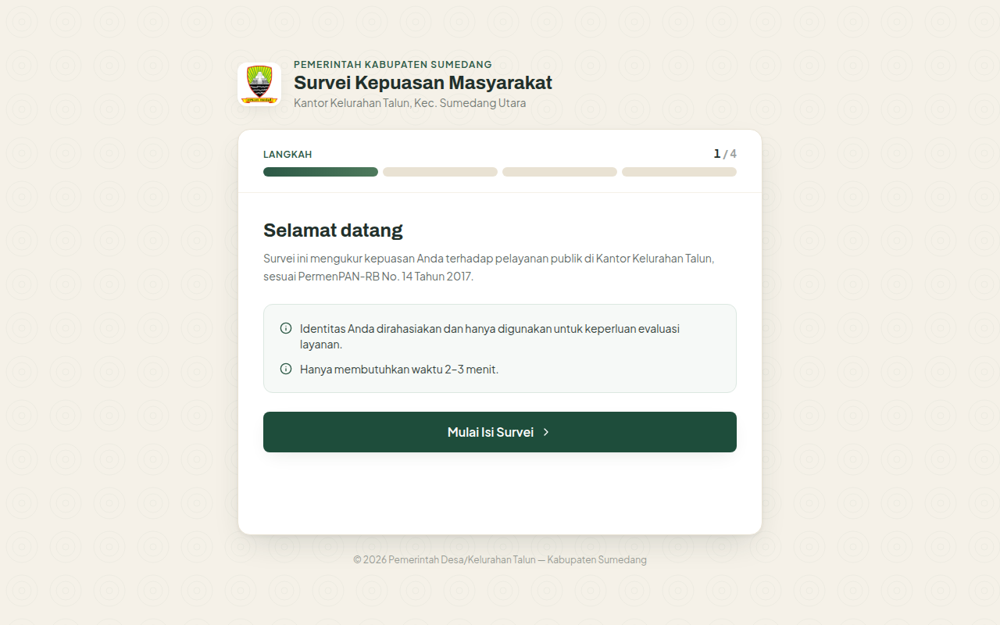
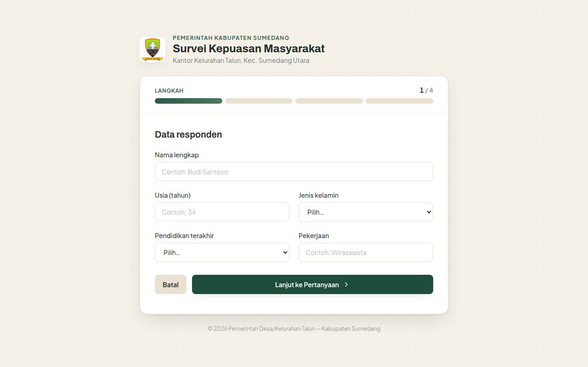
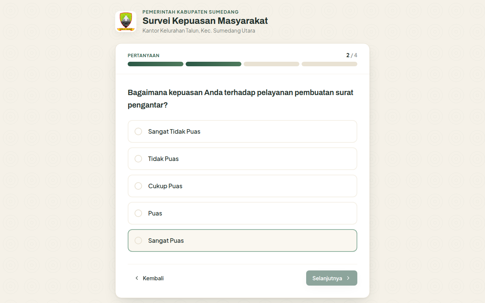
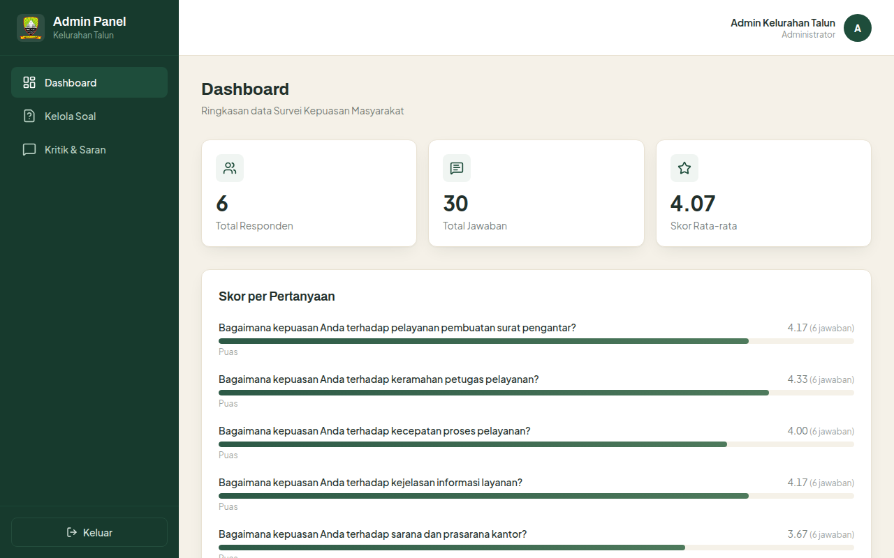
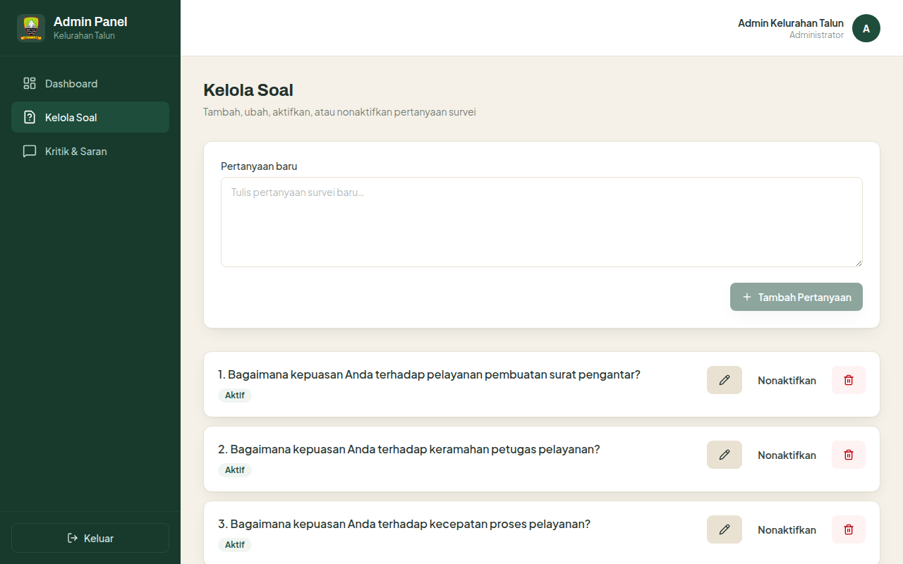
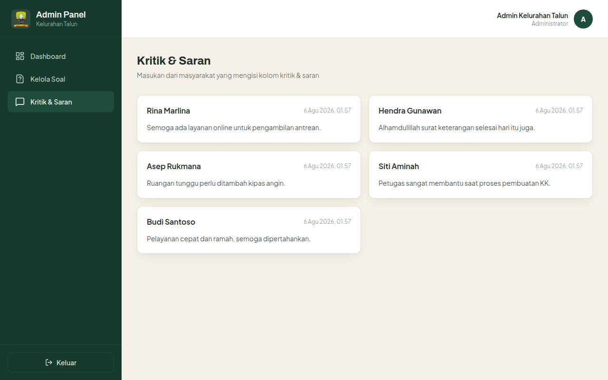

# Survei Kepuasan Masyarakat Kelurahan Talun

[](https://github.com/mifdlaldev/survei-kepuasan-talun/blob/main/LICENSE)
[](https://github.com/mifdlaldev/survei-kepuasan-talun/releases)
[](https://github.com/mifdlaldev/survei-kepuasan-talun/actions)
[](https://survei-kepuasan-talun.mifdlaltsaqibalf25.workers.dev)
[](CODE_OF_CONDUCT.md)

> Website resmi Survei Kepuasan Masyarakat (SKM) terhadap kualitas pelayanan publik di **Kantor Kelurahan Talun, Kecamatan Sumedang Utara, Kabupaten Sumedang, Jawa Barat**.

## Tentang

Survei Kepuasan Masyarakat (SKM) merupakan instrumen pengukuran tingkat kepuasan masyarakat terhadap kualitas pelayanan publik, sesuai amanat **PermenPAN-RB No. 14 Tahun 2017** tentang Pedoman Penyusunan Survei Kepuasan Masyarakat Unit Penyelenggara Pelayanan Publik.

Aplikasi ini memungkinkan masyarakat mengisi survei secara daring dari perangkat masing-masing (ponsel/komputer), menggantikan metode kertas yang lebih lambat dan rentan kehilangan data. Hasil survei dikelola melalui dashboard admin dan dijadikan bahan evaluasi peningkatan kualitas pelayanan.

## Fitur

### Halaman Publik (Warga)
- Formulir survei multi-langkah dengan skala Likert 1–5
- Pengisian data responden (nama, jenis kelamin, usia, pendidikan, pekerjaan)
- Kolom kritik & saran opsional
- Responsif di perangkat seluler maupun desktop
- Animasi transisi halus antar langkah

### Dashboard Admin
- Login admin dengan sesi aman (cookie `HttpOnly`, password ter-hash)
- Dashboard ringkasan data responden dan skor survei
- Kelola daftar pertanyaan (tambah, ubah, aktif/nonaktif)
- Lihat seluruh feedback kritik & saran dari masyarakat

## Tampilan (Screenshot)

| Halaman Survei | Form Data Responden |
|---|---|
|  |  |

| Pertanyaan Survei | Dashboard Admin |
|---|---|
|  |  |

| Kelola Soal | Kritik & Saran |
|---|---|
|  |  |

## Keamanan

- **Semua akses database lewat API Worker** — browser tidak pernah memegang kredensial database.
- Password di-hash dengan **PBKDF2-SHA256** (salt acak per akun), tidak pernah disimpan mentah.
- Sesi login menggunakan **cookie `HttpOnly` + `SameSite=Lax` + `Secure`** — tidak bisa dibaca/diubah JavaScript (bukan localStorage).
- **Rate limiting per-IP** pada endpoint publik (anti-spam form) dan login.
- **Validasi input di sisi server** dengan [Zod](https://zod.dev) — klien tidak pernah dipercaya.
- SQL berparameter (prepared statements) — tahan injeksi.
- Pelaporan kerentanan: lihat [SECURITY.md](SECURITY.md).

## Teknologi

| Layer | Teknologi |
|-------|-----------|
| Frontend | [React](https://react.dev) 19, [Vite](https://vite.dev) 7, TypeScript |
| Styling | [Tailwind CSS](https://tailwindcss.com) 4, [Framer Motion](https://www.framer.com/motion/), [lucide-react](https://lucide.dev) |
| Routing | [React Router](https://reactrouter.com) 7 |
| API | [Hono](https://hono.dev) di [Cloudflare Workers](https://workers.cloudflare.com) |
| Database | [Cloudflare D1](https://developers.cloudflare.com/d1/) (SQLite) |
| Deployment | [Cloudflare Workers](https://workers.cloudflare.com) + static assets |

## Struktur Proyek

```
├── src/                      # Frontend React + TypeScript
│   ├── App.tsx               # Routing utama (publik + admin)
│   ├── pages/
│   │   ├── SurveiPage.tsx    # Halaman survei publik
│   │   └── admin/            # Login, Dashboard, Kelola Soal, Kritik & Saran
│   ├── components/           # UI bersama + pola batik + progress ruas bambu
│   └── lib/
│       ├── api.ts            # Klien API (fetch ke /api)
│       └── types.ts          # Tipe data bersama
├── worker/                   # Cloudflare Worker (API)
│   ├── index.ts              # Entry Hono + SPA fallback
│   └── src/
│       ├── routes/           # Rute publik + admin
│       ├── middleware/       # Auth sesi + rate limiting
│       └── lib/              # PBKDF2, sesi, validasi Zod
├── migrations/               # Skema SQL D1
└── wrangler.toml             # Konfigurasi Workers + binding D1
```

## Persyaratan

- Node.js 20+ dan npm
- Akun [Cloudflare](https://dash.cloudflare.com) dengan hak akses Workers + D1

## Instalasi Lokal

```bash
# 1. Clone repositori
git clone https://github.com/mifdlaldev/survei-kepuasan-talun.git
cd survei-kepuasan-talun

# 2. Install dependensi
npm install

# 3. Login Cloudflare (buka browser, klik Allow)
npx wrangler login

# 4. Buat database D1 + isi database_id di wrangler.toml
npx wrangler d1 create survei-kepuasan-talun-db
#   Salin nilai database_id dari output ke wrangler.toml

# 5. Terapkan skema database (lokal)
npm run db:generate

# 6. Jalankan server pengembangan (API + frontend)
npx wrangler dev --local --port 8787
```

## Skrip Tersedia

| Perintah | Deskripsi |
|----------|-----------|
| `npm run dev` | Menjalankan Vite dev server frontend |
| `npm run build` | Type-check + build frontend ke `dist/` |
| `npm run lint` | Pemeriksaan kode ESLint |
| `npm run db:generate` | Terapkan migration D1 ke database lokal |
| `npm run db:deploy` | Terapkan migration D1 ke database remote |
| `npm run db:seed-admin` | Buat akun admin pertama (`npm run db:seed-admin -- <username> <password> <nama>`) |

## Deployment

```bash
npm run build        # 1. Build frontend
npx wrangler deploy  # 2. Deploy worker + assets + D1 ke Cloudflare
```

```
https://survei-kepuasan-talun.mifdlaltsaqibalf25.workers.dev
```

## Kontribusi

Kami menyambut kontribusi dari siapa pun. Baca [CONTRIBUTING.md](CONTRIBUTING.md) untuk panduan memulai, dan [Kode Etik](CODE_OF_CONDUCT.md) sebagai pedoman perilaku.

Riwayat perubahan: [CHANGELOG.md](CHANGELOG.md) · Butuh bantuan: [SUPPORT.md](SUPPORT.md)

## Lisensi

Kode sumber dilisensikan di bawah **Apache License 2.0** — lihat [LICENSE](LICENSE).

Logo dan aset visual lainnya merupakan milik instansi masing-masing dan tidak tercakup dalam lisensi ini.
